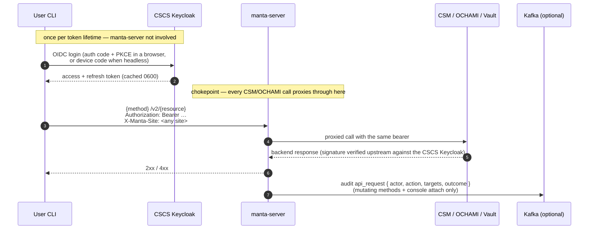

# Security Policy

This document is for **security researchers, operators, and integrators**
who need to understand manta's security model end-to-end or who have
found a potential vulnerability.

For deeper technical detail on each control, see
[ARCHITECTURE.md §Security model](ARCHITECTURE.md#security-model). For
the removal of the previously-shipped `manta-read-only` JWT-role gate,
see [MIGRATING.md §5.12](MIGRATING.md#512-server-side-manta-read-only-jwt-role-enforcement-removed-breaking).
For the user-facing description of the CLI-side read-only flag that
remains, see [GUIDE.md §13](GUIDE.md#13-read-only-access).

## Reporting a vulnerability

**Do not open a public GitHub issue for a suspected vulnerability.**
We use private disclosure channels:

1. **Preferred — GitHub Security Advisories.** Open a private advisory
   at
   <https://github.com/eth-cscs/manta/security/advisories/new>.
   This keeps the report invisible to the public while the fix is
   prepared.
2. **Fallback — email.** If you cannot use GitHub Security Advisories,
   email the maintainers directly:
   - Manuel Sopena Ballesteros — `msopena@cscs.ch`
   - Miguel Gila — `miguel.gila@cscs.ch`
   Use a subject prefix like `[manta-security]` so the report routes
   correctly. PGP is not currently configured for these addresses —
   if you need encrypted transport, reach out first to coordinate.

Please include, at minimum:

- The version (`manta --version` and `manta-server --version`) where you
  observed the issue.
- A reproduction (HTTP request, CLI invocation, or test script).
- The impact you assess (what an attacker can do).
- Your disclosure timeline preference, if any.

We will acknowledge receipt within **5 working days** and provide a
status update within **15 working days**. If the report is in scope, a
fix and coordinated disclosure timeline will be agreed before any
public discussion of the issue.

## Supported versions

manta 2.x is the actively-maintained line; the 1.x series did not
have a server binary and is no longer maintained.

| Version | Status | Security fixes |
|---|---|---|
| `2.0.0-beta.x` (current) | active development | yes — on `main` |
| `2.0.0` (when released) | active | yes — backported to the release branch |
| `1.x` | unmaintained | **no** |

During the `2.0.0-beta.x` series, fixes land on `main` and ride out on
the next beta tag. There is no separate security branch — operators
running a pinned beta should plan to upgrade promptly when an advisory
lands.

## Security model — at a glance

manta is a 3-tier system. The sequence below shows the login and a
subsequent authenticated request:

*Sequence: login against the CSCS Keycloak, then an authenticated request.*

For the user-facing read-only flow specifically, see
[GUIDE.md §13 — Read-only access](GUIDE.md#13-read-only-access).
For where the middleware layers sit in the request pipeline, see
[ARCHITECTURE.md → Middleware layer stack](ARCHITECTURE.md#middleware-layer-stack).

- **CLI side** (`manta` binary): a thin client that runs on operator
  workstations. Logs in to the CSCS Keycloak itself (OIDC) and holds
  the resulting access + refresh token in a 0600 cache file
  (`token.json`) under the platform cache dir. One token serves every
  site. Never speaks to CSM/OCHAMI directly.
- **Server side** (`manta-server` binary): the request chokepoint.
  Never sees user credentials — it has no auth endpoints. On every
  request it exchanges the user's CSCS token at the site's Keycloak
  (RFC 8693, with a per-site exchange client secret from
  `server.toml`) and proxies backend calls with the resulting CSM
  token. Nothing is cached.
- **Upstream** (CSCS Keycloak / CSM / OpenCHAMI / Vault): not part of
  this repo. Each CSM site's Keycloak trusts the CSCS Keycloak as an
  identity provider and verifies the CSCS token's signature during
  the exchange; CSM and Vault trust the site's own Keycloak.

Because every request through `manta-server` carries a bearer token
that every site will exchange, and the server holds each site's
exchange client secret and per-site service-account tokens (for k8s,
Vault, Gitea), **it is
a single point of compromise** for every site it serves. Operate it
accordingly.

## Controls — what is enforced where

### In code (the manta binaries)

| Control | Where | Notes |
|---|---|---|
| TLS required by default | `manta-server` | Server fails closed without `cert` + `key`. Pass `--allow-http` only when TLS terminates upstream. |
| HSTS on every response | `manta-server` | `Strict-Transport-Security: max-age=31536000; includeSubDomains`. No-op over plain HTTP per RFC 6797. |
| No credentials on the server | `manta-server` | Login happens between the CLI and the CSCS Keycloak; the server has no auth endpoints. Brute-force protection and login auditing are the Keycloak's. |
| PKCE, `state`, nonce and `at_hash` checks on login | `manta-cli` | `common::oidc`: the browser flow uses S256 PKCE on a loopback redirect, rejects a mismatched `state`, and verifies the ID token's nonce and `at_hash` against the realm's JWKS. Redirects are never followed on Keycloak calls. |
| Audit trail of every mutation | `manta-server` | `server::audit::audit_requests` records one event per mutating `/v2` request and per console attach, with outcome, after the response. Always logged on the `manta::audit` target, and produced to Kafka when `[auditor.kafka]` is set. Fail-open: a broker outage never fails a request. No token, password or raw body is ever recorded. See [ARCHITECTURE.md § Audit trail](ARCHITECTURE.md#audit-trail). |
| CLI-side read-only guard | `manta-cli` | Refuses mutating verbs locally when `cli.toml` has `read_only = true`, before any HTTP request leaves the process. Client-side accident guard only — `manta-server` does not enforce this; see [GUIDE.md §13](GUIDE.md#13-read-only-access). |
| 0600 mode on cached tokens | `manta-cli` | `token.json` written with `0600` perms in a `0700` platform cache dir; `TokenStore`'s `Debug` redacts every token, so tokens are never logged. |

### In ops (your deployment)

| Control | Notes |
|---|---|
| TLS termination, WAF, reverse-proxy rate limit | First line of defence. |
| Token lifetime and scope in the CSCS Keycloak | Short access-token lifetimes bound the replay window of a leaked token; the manta client's claims (`realm_access.roles`, audience) bound what it can do at each site. |
| Service-account scoping at CSM / Vault | Limit what the server's per-site service-account tokens can do at the backend. |
| Network segmentation | Treat manta-server as a privileged host. |
| `[server].migrate_backup_root` set explicitly | Confines `POST /migrate/{backup,restore}` paths. Server returns `400` for those endpoints when unset, even for admin callers. |

## Known limitations

**No local signature verification.** `manta_shared::common::jwt_ops`
decodes the JWT body without verifying its signature. This is
documented inline at the top of that module. (`manta-server`'s
`server::common::jwt_ops` is a re-export shim over it, kept so
existing call sites resolve — the caveat lives at the canonical
path.) Consequences:

- The `is_user_admin` role gate is **advisory** in the sense that a
  forged token passing the decode step is detected only at the first
  backend round-trip, where CSM/OCHAMI rejects it.
- The role gate is still useful as **defence in depth**: it reduces
  the blast radius of a token whose signature does verify but whose
  user's permissions should be tighter than what the backend would
  otherwise allow.
- Local JWKS-based signature verification (per-site cache, `kid`-based
  rotation) is the long-term direction. The role gate inherits that
  verification automatically when it lands; no per-gate work needed.

**Single point of compromise.** As noted above, owning `manta-server`
gives an attacker every live bearer token that passes through it —
each valid on every site trusting the CSCS Keycloak until it expires —
and access to configured service-account tokens. Mitigations are
mostly ops: short token lifetimes in the Keycloak, TLS termination
upstream, service-account scoping, network segmentation.

**One token for every site.** A leaked access token (e.g. from a
`MANTA_TOKEN` in a CI log) works against every site, not just one.
Keep `MANTA_TOKEN` out of logs and rely on the Keycloak's token
lifetime to bound the damage.

## Cryptography notes

- **TLS:** ring (the `rustls` `CryptoProvider`); 1.2/1.3 per `rustls`
  defaults. Configure cipher suites and protocol versions at your
  reverse proxy if you need to constrain them further.
- **JWT decode:** `base64::prelude::BASE64_URL_SAFE_NO_PAD` with a
  fall-back to `BASE64_STANDARD`. No signature verification (see Known
  limitations).
- **Password handling:** manta never sees a password. The user
  authenticates to the CSCS Keycloak in a browser (or on another
  device, for the device-code flow); the CLI receives only tokens.
- **OIDC:** `openidconnect` for PKCE (S256) and ID-token verification
  (signature against the realm's JWKS, nonce, `at_hash`).

## Out of scope for this document

- Code-quality issues that are not security-relevant — open a regular
  GitHub issue.
- Vulnerabilities in upstream sibling crates (`csm-rs`, `ochami-rs`,
  `manta-backend-dispatcher`) — report directly against those repos.
  If you're unsure where a finding belongs, send it here and we will
  triage.
- Vulnerabilities in the user's identity provider (Keycloak, etc.) or
  in the backends (CSM, OpenCHAMI) — out of manta's scope; report
  upstream.
